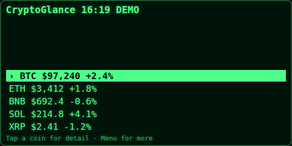
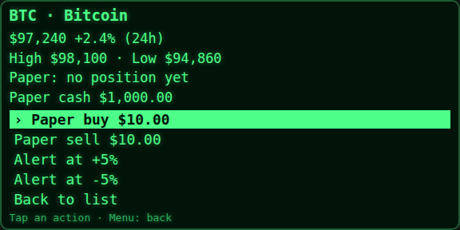
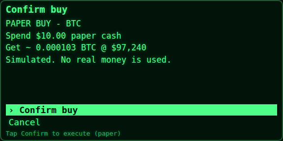
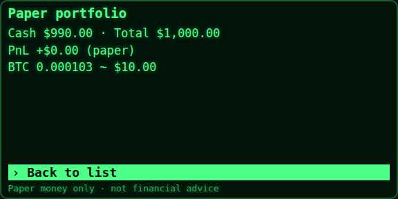

# CryptoGlance

**A glanceable crypto companion for Even Realities G2 smart glasses.**
Live prices, price alerts and paper trading — readable in one glance, actionable in two taps, without ever taking your phone out of your pocket.

Built for **Heads Up: The Even Realities Hackathon** (DoraHacks), track **Crypto & DeFi**.

## What it does

- **Watchlist (read):** live BTC, ETH, BNB, SOL and XRP prices with 24h change, refreshed every 30 seconds and rendered big on the G2's 576×288 monochrome display. Detail view adds 24h high/low.
- **Paper trading (write):** from any coin, buy or sell a $10 paper position. Every trade goes through an explicit on-glasses confirm screen first — the same quick-confirm pattern real trading apps need, with zero real-money risk.
- **Price alerts (write):** set an alert at +5% or −5% from the current price in two taps. When the market hits your target, the alert takes over the display: `PRICE ALERT — BTC is now $…`.
- **Paper portfolio:** cash, positions, total value and PnL, persisted between sessions (Even App storage on device, `localStorage` in the browser preview). Starts with $1,000 of paper money.

## Safety

Paper trading only, by design. CryptoGlance never touches real funds, wallets, exchange accounts or API keys. Price data comes from public, keyless, read-only endpoints. It is not financial advice.

## Screenshots

Captured from the app's built-in 576×288 preview (identical view-model to what the SDK renders on the glasses):

| Watchlist | Coin detail |
| --- | --- |
|  |  |

| Confirm a paper trade | Paper portfolio |
| --- | --- |
|  |  |

## Run it in the Even Hub simulator

Prerequisites: Node.js 20+, the official Even Hub tooling:

```bash
npm install -g @evenrealities/evenhub-cli @evenrealities/evenhub-simulator
```

Then:

```bash
npm install
npm run dev            # serves the app at http://127.0.0.1:5173
```

In a second terminal:

```bash
evenhub-simulator http://127.0.0.1:5173 --automation-port 9898
```

Use the simulator's Up / Down / Click inputs (or its automation API) to navigate: select a coin, open the contextual menu for Portfolio / Alerts / Refresh, set an alert, and run a paper trade through its confirm screen.

No simulator handy? Open http://127.0.0.1:5173 in any browser — the app detects the missing Even App bridge and switches to a pixel-exact 576×288 preview with on-screen controls (arrow keys + Enter work too).

Package a distributable build (optional submission artifact):

```bash
npm run pack           # builds dist/ and stamps cryptoglance.ehpk via evenhub pack
```

## Verify the flows headlessly

```bash
npm run build
npx serve dist -l 4173 # or: python3 -m http.server 4173 --directory dist
node scripts/verify.mjs          # drives watchlist -> detail -> confirm -> buy -> portfolio
node scripts/validate-page.mjs   # checks both glasses page layouts against the SDK validator
```

## How it works

- **Stack:** TypeScript + Vite, official `@evenrealities/even_hub_sdk` (0.0.16). The glasses UI is rendered with SDK containers (header/body text + one event-capture list + a contextual menu per screen); one shared view-model also drives the in-browser preview, so what you see in development is what the glasses show.
- **Data:** Binance public ticker API (keyless) → CoinGecko public API fallback → bundled sample data (clearly flagged `DEMO` in the header) so the UI never goes blank. Both hosts are whitelisted in `app.json`; no API keys anywhere.
- **State machine:** `watchlist → detail → confirm → message`, plus `portfolio`, `alerts`, and a full-screen `alertFired` state. Alerts are evaluated on every 30-second refresh.
- **Display discipline:** short ASCII strings only (list items ≤ 63 bytes, text ≤ 999 bytes per SDK limits), large type, one idea per screen — designed for a green monochrome 576×288 panel, not a shrunk phone UI.

## Hackathon declaration — pre-existing work

Per the hackathon rules (building starts at the 23 Nov kickoff; existing libraries/APIs are allowed and must be declared): this repository's initial scaffold and first working prototype were prepared **before** the kickoff for planning purposes, using only the public Even Hub SDK, CLI and simulator and public price APIs. Everything in the repo at the time of submission will be re-verified end-to-end in the simulator during the official build window, and any further feature work happens inside that window. No code from other projects is included; all application code is original to this repo.

## Roadmap ideas

- Voice commands via the glasses microphone (the SDK exposes raw audio; bring-your-own speech-to-text), e.g. "alert me when BTC crosses 100k".
- More assets and user-editable watchlists; Polymarket/Kalshi odds for the same glanceable treatment.
- Optional Telegram alert mirror (Best Telegram Integration) via a small backend relay.

## License

MIT
